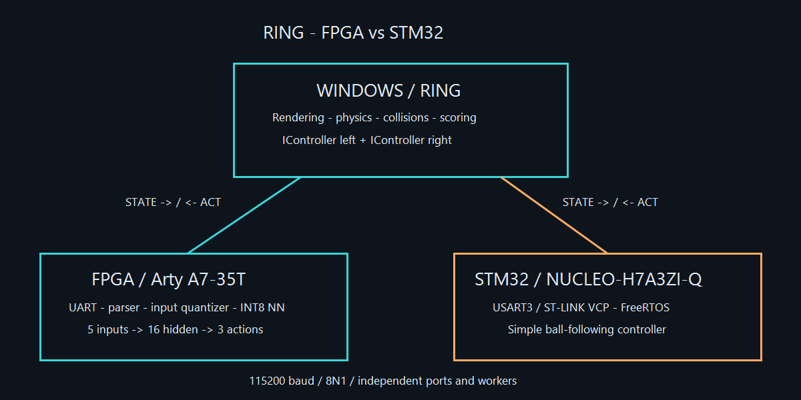
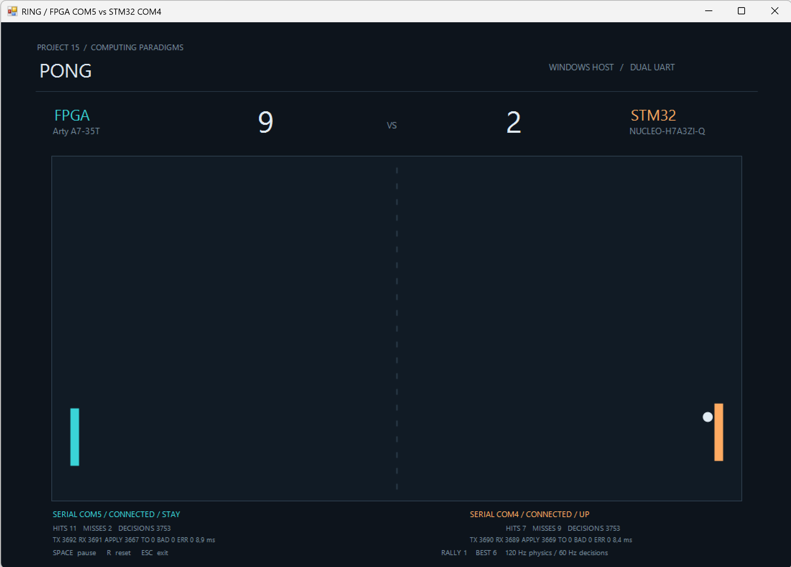

# RING — FPGA vs STM32

One Pong game, two computing paradigms. Windows owns physics, collisions, scoring and rendering. Each device receives STATE and returns UP, DOWN or STAY over UART.





User-provided screenshot: both boards connected, score 9–2. This is one match snapshot, not an aggregate performance benchmark.

## Repository layout

```text
host/RING Windows/    C# WinForms application, controllers and tests
fpga/rtl/            Existing INT8 NN, UART, parser and top modules
fpga/constraints/    Arty A7-35T and loopback constraints
fpga/sim/            Testbenches, reference generators and vectors
fpga/tools/          Existing Vivado and physical UART test scripts
stm32/               Core, Drivers, FreeRTOS, CubeIDE project and tests
ml/                  Training, quantization, HDL export and models
docs/results/        Historical simulation, timing and hardware evidence
docs/screenshots/    Match screenshots and application renders
```

## Run the Windows host

From this directory, on Windows with .NET Framework 4.x:

```powershell
& '.\host\RING Windows\build.ps1' -Test
& '.\host\RING Windows\bin\PongExperiment.exe' --list-ports
& '.\host\RING Windows\bin\PongExperiment.exe' --fpga-mode serial --fpga-port COM5 --stm32-mode serial --stm32-port COM4
```

Select the actual ports after enumeration. COM5/COM4 were used in the recorded hardware test; these names are not universal board identifiers. Without arguments, the FPGA is simulated and STM32 uses COM4. Each SerialController has its own port, worker, deadline and telemetry. An unavailable device uses STAY without blocking the other. Space pauses, R resets and Esc exits.

## UART protocol

115200 baud, 8N1, no flow control. ASCII lines terminated by LF:

```text
STATE,1,42,L,424,271,-5,3,180,200,960,480,80
ACT,1,42,UP
```

STATE fields: token, version, tick, L/R, ball X/Y, velocity X/Y, own/opponent paddle center, field width, field height and paddle height. ACT echoes the request tick and returns UP/DOWN/STAY. The origin is top left, positive Y points down, and velocities are pixels/second. The host uses unique, potentially large ticks and a 16.67 ms response deadline. [Full contract](host/RING%20Windows/docs/UART.md).

## Components and recorded results

- [FPGA](fpga/README.md): existing 5→16→3 INT8 NN, UART and input adapter. Recorded Python/RTL agreement: 30,243 vectors, 100%; 38 UART cases. The dataset's 88.75% accuracy is not a Pong win rate.
- [STM32](stm32/README.md): USART3/ST-LINK Virtual COM Port, FreeRTOS and a simple controller. Do not regenerate from the historical `.ioc`.
- [ML](ml/README.md): existing model files and reproducible training/export scripts.
- [Both physical devices](docs/results/dual-physical-match.txt): 40 s, FPGA COM5 received 2,351 ACT / applied 2,326; STM32 COM4 received 2,346 / applied 2,331; no timeouts or connection errors for either. This evidence was copied from the original run, not newly measured while packaging.

This folder combines copies of the existing projects. Original folders were not moved, firmware/RTL logic was not changed, and no boards were programmed. Only organization, documentation and tool paths were adapted. [Inventory and packaging checks](docs/PACKAGING.md).

## Publication status

Nothing has been published and no remote has been created. The publication destination, visibility and license for original project code are still to be selected. ST, CMSIS and FreeRTOS licenses are retained in their directories and are not replaced by another license. Temporary logs, executables, bitstreams and regenerable checkpoints are excluded from the source distribution.
